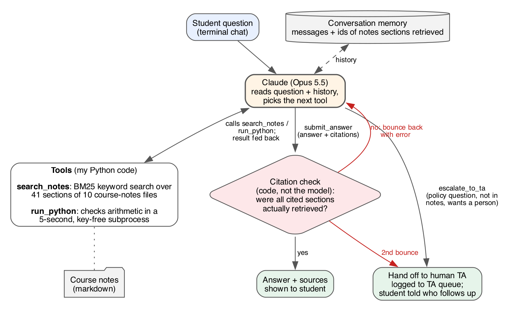

# Office Hours TA

A study agent for an intro machine-learning course. A student asks a question; the agent
searches the course notes, checks any math by running Python, and either answers **with
citations to the notes** or hands the question to a human TA.



## Why it exists

Students get stuck at 11 pm, when office hours are closed. A general chatbot will answer
anything, including things the course never taught or got differently, and it will happily
grant an "extension" it has no authority to give. This agent stays inside the course
material and knows when to say "a person should handle this."

## How it works

- **One agent, four tools**, in a plain Python loop over the Claude API (no framework):
  - `search_notes`: BM25 keyword search over the notes, split into 41 sections
  - `run_python`: runs a short snippet in a separate, time-limited process with no API keys
  - `submit_answer`: the only way to answer; must cite section ids
  - `escalate_to_ta`: logs the question to `ta_queue.jsonl` and tells the student
- **Citation check (in code):** every cited id must be a section `search_notes` returned in
  this conversation. If not, the answer is bounced back to the model with the error; after two
  bounces the question goes to a TA.
- **Memory:** the conversation history and the set of retrieved section ids, for one terminal
  session. Nothing is stored between sessions.

Code: [`officehours/agent.py`](officehours/agent.py) (loop, tools, citation check),
[`corpus.py`](officehours/corpus.py) (chunking + BM25), [`sandbox.py`](officehours/sandbox.py).

## Run it

```bash
pip install -r requirements.txt
export ANTHROPIC_API_KEY=...        # your own key
python -m officehours --trace       # chat in the terminal; --trace shows tool calls and tokens
```

To use your own course, replace the markdown files in `notes/` (one `## ` heading per topic).

## Test it

```bash
python -m pytest -q                       # 14 offline tests; the model is scripted, no key needed
python eval/run_eval.py --retrieval-only  # offline: does search find the right notes file?
python eval/run_eval.py                   # live: 21 cases through the real agent
```

The live eval grades each case without an LLM judge: correct route (answer vs. escalate),
cited the right notes file, key fact or number present, expected tool used, and escalation
reason. Results are saved to `eval/results/`.

## Limits

- Runs locally in a terminal; not deployed.
- `run_python` is a convenience sandbox, not a security boundary. A multi-user deployment
  would need a container.
- The citation check proves a cited section was *retrieved*, not that it *supports* the
  sentence. That would need a second check.
